

  <a href="https://ralphchr.vercel.app/">
    <picture>
<source media="(prefers-color-scheme: light) and (prefers-reduced-motion: reduce)" srcset="./assets/profile-banner-light.svg">
<source media="(prefers-color-scheme: light)" srcset="./assets/profile-banner-animated-light.svg">
<source media="(prefers-reduced-motion: reduce)" srcset="./assets/profile-banner.svg">
</picture>
  </a>

<picture>
<source media="(prefers-color-scheme: light) and (prefers-reduced-motion: reduce) and (max-width: 600px)" srcset="./assets/profile-intro-mobile-light.svg">
<source media="(prefers-color-scheme: light) and (prefers-reduced-motion: reduce)" srcset="./assets/profile-intro-light.svg">
<source media="(prefers-color-scheme: light) and (max-width: 600px)" srcset="./assets/profile-intro-mobile-animated-light.svg">
<source media="(prefers-color-scheme: light)" srcset="./assets/profile-intro-animated-light.svg">
<source media="(prefers-reduced-motion: reduce) and (max-width: 600px)" srcset="./assets/profile-intro-mobile.svg">
<source media="(prefers-reduced-motion: reduce)" srcset="./assets/profile-intro.svg">
<source media="(max-width: 600px)" srcset="./assets/profile-intro-mobile-animated.svg">
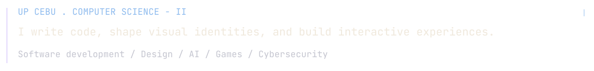
</picture>

<picture>
<source media="(prefers-color-scheme: light) and (prefers-reduced-motion: reduce) and (max-width: 600px)" srcset="./assets/selected-heading-mobile-light.svg">
<source media="(prefers-color-scheme: light) and (prefers-reduced-motion: reduce)" srcset="./assets/selected-heading-light.svg">
<source media="(prefers-color-scheme: light) and (max-width: 600px)" srcset="./assets/selected-heading-mobile-animated-light.svg">
<source media="(prefers-color-scheme: light)" srcset="./assets/selected-heading-animated-light.svg">
<source media="(prefers-reduced-motion: reduce) and (max-width: 600px)" srcset="./assets/selected-heading-mobile.svg">
<source media="(prefers-reduced-motion: reduce)" srcset="./assets/selected-heading.svg">
<source media="(max-width: 600px)" srcset="./assets/selected-heading-mobile-animated.svg">
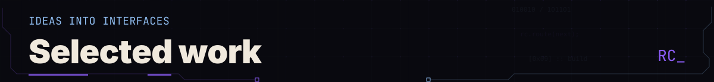
</picture>

<picture>
<source media="(prefers-color-scheme: light) and (prefers-reduced-motion: reduce) and (max-width: 600px)" srcset="./assets/project-index-mobile-light.svg">
<source media="(prefers-color-scheme: light) and (prefers-reduced-motion: reduce)" srcset="./assets/project-index-light.svg">
<source media="(prefers-color-scheme: light) and (max-width: 600px)" srcset="./assets/project-index-mobile-animated-light.svg">
<source media="(prefers-color-scheme: light)" srcset="./assets/project-index-animated-light.svg">
<source media="(prefers-reduced-motion: reduce) and (max-width: 600px)" srcset="./assets/project-index-mobile.svg">
<source media="(prefers-reduced-motion: reduce)" srcset="./assets/project-index.svg">
<source media="(max-width: 600px)" srcset="./assets/project-index-mobile-animated.svg">
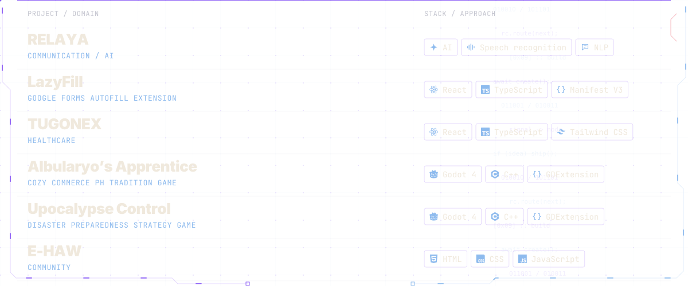
</picture>

<picture>
<source media="(prefers-color-scheme: light) and (prefers-reduced-motion: reduce) and (max-width: 600px)" srcset="./assets/toolkit-heading-mobile-light.svg">
<source media="(prefers-color-scheme: light) and (prefers-reduced-motion: reduce)" srcset="./assets/toolkit-heading-light.svg">
<source media="(prefers-color-scheme: light) and (max-width: 600px)" srcset="./assets/toolkit-heading-mobile-animated-light.svg">
<source media="(prefers-color-scheme: light)" srcset="./assets/toolkit-heading-animated-light.svg">
<source media="(prefers-reduced-motion: reduce) and (max-width: 600px)" srcset="./assets/toolkit-heading-mobile.svg">
<source media="(prefers-reduced-motion: reduce)" srcset="./assets/toolkit-heading.svg">
<source media="(max-width: 600px)" srcset="./assets/toolkit-heading-mobile-animated.svg">
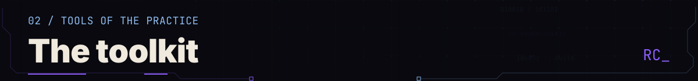
</picture>

<picture>
<source media="(prefers-color-scheme: light) and (prefers-reduced-motion: reduce) and (max-width: 600px)" srcset="./assets/toolkit-mobile-light.svg">
<source media="(prefers-color-scheme: light) and (prefers-reduced-motion: reduce)" srcset="./assets/toolkit-light.svg">
<source media="(prefers-color-scheme: light) and (max-width: 600px)" srcset="./assets/toolkit-mobile-animated-light.svg">
<source media="(prefers-color-scheme: light)" srcset="./assets/toolkit-animated-light.svg">
<source media="(prefers-reduced-motion: reduce) and (max-width: 600px)" srcset="./assets/toolkit-mobile.svg">
<source media="(prefers-reduced-motion: reduce)" srcset="./assets/toolkit.svg">
<source media="(max-width: 600px)" srcset="./assets/toolkit-mobile-animated.svg">
</picture>

<picture>
<source media="(prefers-color-scheme: light) and (prefers-reduced-motion: reduce) and (max-width: 600px)" srcset="./assets/github-heading-mobile-light.svg">
<source media="(prefers-color-scheme: light) and (prefers-reduced-motion: reduce)" srcset="./assets/github-heading-light.svg">
<source media="(prefers-color-scheme: light) and (max-width: 600px)" srcset="./assets/github-heading-mobile-animated-light.svg">
<source media="(prefers-color-scheme: light)" srcset="./assets/github-heading-animated-light.svg">
<source media="(prefers-reduced-motion: reduce) and (max-width: 600px)" srcset="./assets/github-heading-mobile.svg">
<source media="(prefers-reduced-motion: reduce)" srcset="./assets/github-heading.svg">
<source media="(max-width: 600px)" srcset="./assets/github-heading-mobile-animated.svg">
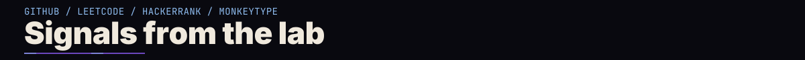
</picture>

<a href="https://github.com/ralphchr"><picture>
<source media="(prefers-color-scheme: light) and (prefers-reduced-motion: reduce)" srcset="./assets/consistency-light.svg">
<source media="(prefers-color-scheme: light)" srcset="./assets/consistency-animated-light.svg">
<source media="(prefers-reduced-motion: reduce)" srcset="./assets/consistency.svg">
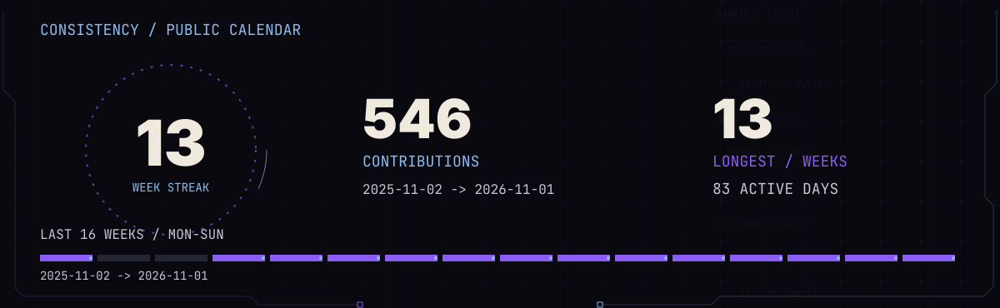
</picture></a>
<a href="https://leetcode.com/u/ralphchr/"><picture>
<source media="(prefers-color-scheme: light) and (prefers-reduced-motion: reduce)" srcset="./assets/leetcode-light.svg">
<source media="(prefers-color-scheme: light)" srcset="./assets/leetcode-animated-light.svg">
<source media="(prefers-reduced-motion: reduce)" srcset="./assets/leetcode.svg">
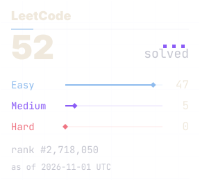
</picture></a>
<a href="https://www.hackerrank.com/profile/ralphchr"><picture>
<source media="(prefers-color-scheme: light) and (prefers-reduced-motion: reduce)" srcset="./assets/hackerrank-light.svg">
<source media="(prefers-color-scheme: light)" srcset="./assets/hackerrank-animated-light.svg">
<source media="(prefers-reduced-motion: reduce)" srcset="./assets/hackerrank.svg">
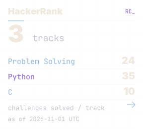
</picture></a>
<a href="https://monkeytype.com/profile/ralphchr"><picture>
<source media="(prefers-color-scheme: light) and (prefers-reduced-motion: reduce)" srcset="./assets/monkeytype-light.svg">
<source media="(prefers-color-scheme: light)" srcset="./assets/monkeytype-animated-light.svg">
<source media="(prefers-reduced-motion: reduce)" srcset="./assets/monkeytype.svg">
</picture></a>

<a href="https://github.com/ralphchr"><picture>
<source media="(prefers-color-scheme: light) and (prefers-reduced-motion: reduce) and (max-width: 600px)" srcset="./assets/activity-mobile-light.svg">
<source media="(prefers-color-scheme: light) and (prefers-reduced-motion: reduce)" srcset="./assets/activity-light.svg">
<source media="(prefers-color-scheme: light) and (max-width: 600px)" srcset="./assets/activity-mobile-animated-light.svg">
<source media="(prefers-color-scheme: light)" srcset="./assets/activity-animated-light.svg">
<source media="(prefers-reduced-motion: reduce) and (max-width: 600px)" srcset="./assets/activity-mobile.svg">
<source media="(prefers-reduced-motion: reduce)" srcset="./assets/activity.svg">
<source media="(max-width: 600px)" srcset="./assets/activity-mobile-animated.svg">
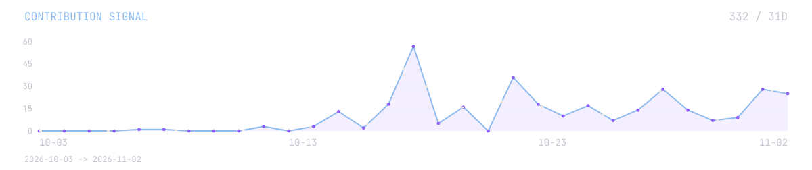
</picture></a>

<picture>
<source media="(prefers-color-scheme: light) and (prefers-reduced-motion: reduce) and (max-width: 600px)" srcset="./assets/beyond-code-mobile-light.svg">
<source media="(prefers-color-scheme: light) and (prefers-reduced-motion: reduce)" srcset="./assets/beyond-code-light.svg">
<source media="(prefers-color-scheme: light) and (max-width: 600px)" srcset="./assets/beyond-code-mobile-animated-light.svg">
<source media="(prefers-color-scheme: light)" srcset="./assets/beyond-code-animated-light.svg">
<source media="(prefers-reduced-motion: reduce) and (max-width: 600px)" srcset="./assets/beyond-code-mobile.svg">
<source media="(prefers-reduced-motion: reduce)" srcset="./assets/beyond-code.svg">
<source media="(max-width: 600px)" srcset="./assets/beyond-code-mobile-animated.svg">
</picture>

<picture>
<source media="(prefers-color-scheme: light) and (prefers-reduced-motion: reduce) and (max-width: 600px)" srcset="./assets/connect-heading-mobile-light.svg">
<source media="(prefers-color-scheme: light) and (prefers-reduced-motion: reduce)" srcset="./assets/connect-heading-light.svg">
<source media="(prefers-color-scheme: light) and (max-width: 600px)" srcset="./assets/connect-heading-mobile-animated-light.svg">
<source media="(prefers-color-scheme: light)" srcset="./assets/connect-heading-animated-light.svg">
<source media="(prefers-reduced-motion: reduce) and (max-width: 600px)" srcset="./assets/connect-heading-mobile.svg">
<source media="(prefers-reduced-motion: reduce)" srcset="./assets/connect-heading.svg">
<source media="(max-width: 600px)" srcset="./assets/connect-heading-mobile-animated.svg">
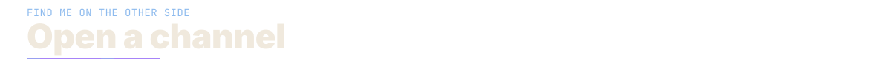
</picture>

<a href="https://www.facebook.com/ralphchrr"><picture>
<source media="(prefers-color-scheme: light) and (prefers-reduced-motion: reduce)" srcset="./assets/contact-facebook-light.svg">
<source media="(prefers-color-scheme: light)" srcset="./assets/contact-facebook-animated-light.svg">
<source media="(prefers-reduced-motion: reduce)" srcset="./assets/contact-facebook.svg">
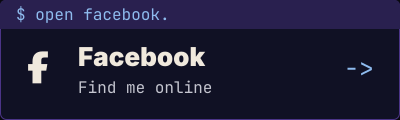
</picture></a>
<a href="https://www.linkedin.com/in/ralph-christian-borbon-5923a2356/"><picture>
<source media="(prefers-color-scheme: light) and (prefers-reduced-motion: reduce)" srcset="./assets/contact-linkedin-light.svg">
<source media="(prefers-color-scheme: light)" srcset="./assets/contact-linkedin-animated-light.svg">
<source media="(prefers-reduced-motion: reduce)" srcset="./assets/contact-linkedin.svg">
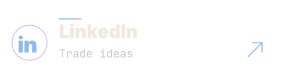
</picture></a>
<a href="mailto:borbon.rchr@gmail.com"><picture>
<source media="(prefers-color-scheme: light) and (prefers-reduced-motion: reduce)" srcset="./assets/contact-gmail-light.svg">
<source media="(prefers-color-scheme: light)" srcset="./assets/contact-gmail-animated-light.svg">
<source media="(prefers-reduced-motion: reduce)" srcset="./assets/contact-gmail.svg">
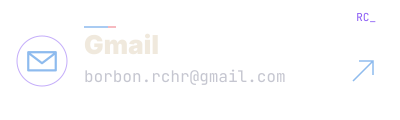
</picture></a>

