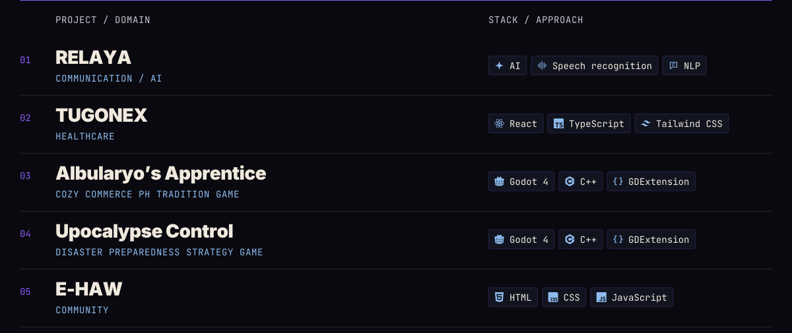
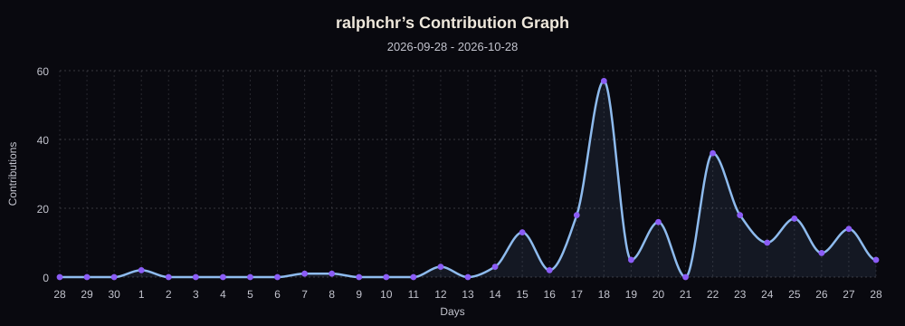

<picture>
  <source media="(prefers-reduced-motion: reduce)" srcset="./assets/profile-banner.svg">
  
</picture>

# Ralph Christian Borbon

I’m Ralph, a **Computer Science student at UP Cebu**, based in **Cebu, Philippines**. I write code, shape visual identities, and build interactive experiences.

My interests move between software development, design, AI, games, and cybersecurity. I’m drawn to work that connects those worlds: a clearer conversation, a more prepared community, or a game worth exploring.

## `01 /` Selected work

<picture>
  <source media="(max-width: 600px)" srcset="./assets/project-index-mobile.svg">
  
</picture>

## `02 /` Toolkit

### Languages

  
  
  
  
  
  
  
  
  

### Frameworks & Libraries

  
  
  
  
  

### Applications & Development Tools

  
  
  
  

### Security Exploration

  
  
  

### Creative & Design Skills

#### Design Tools

  
  
  
  
  
  

#### Video & Motion Graphics

  
  

## `03 /` On GitHub

<h3 align="center">Consistency</h3>

  

<h3 align="center">Git Activity</h3>

<picture>
  <source media="(max-width: 600px)" srcset="./assets/activity-mobile.svg">
  
</picture>

## `04 /` Beyond the code

I’m the **Marketing Director at the UP Computer Science Guild**, a **Seasonal Tutor**, a **Freelance Graphic Designer**, and a **Competitive Gamer**.

## `05 /` Let’s connect

[Facebook](https://www.facebook.com/ralphchrr) · [LinkedIn](https://www.linkedin.com/in/ralph-christian-borbon-5923a2356/) · [Gmail](mailto:borbon.rchr@gmail.com)
