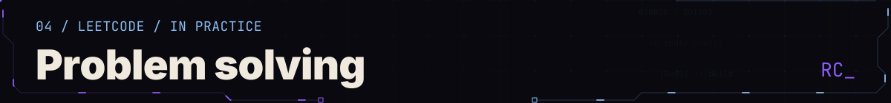
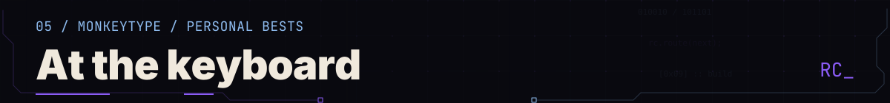
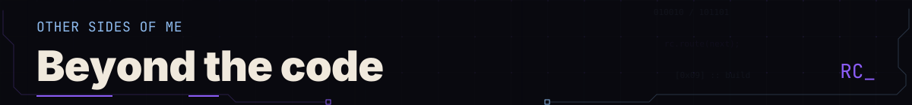

  <a href="https://ralphchr.vercel.app/">
    <picture>
      <source media="(prefers-reduced-motion: reduce)" srcset="./assets/profile-banner.svg">
      
    </picture>
  </a>

  <picture>
    <source media="(prefers-reduced-motion: reduce) and (max-width: 600px)" srcset="./assets/profile-intro-mobile.svg">
    <source media="(prefers-reduced-motion: reduce)" srcset="./assets/profile-intro.svg">
    <source media="(max-width: 600px)" srcset="./assets/profile-intro-mobile-animated.svg">
    
  </picture>

  <picture>
    <source media="(prefers-reduced-motion: reduce) and (max-width: 600px)" srcset="./assets/selected-heading-mobile.svg">
    <source media="(prefers-reduced-motion: reduce)" srcset="./assets/selected-heading.svg">
    <source media="(max-width: 600px)" srcset="./assets/selected-heading-mobile-animated.svg">
    
  </picture>

  <picture>
    <source media="(prefers-reduced-motion: reduce) and (max-width: 600px)" srcset="./assets/project-index-mobile.svg">
    <source media="(prefers-reduced-motion: reduce)" srcset="./assets/project-index.svg">
    <source media="(max-width: 600px)" srcset="./assets/project-index-mobile-animated.svg">
    
  </picture>

  <picture>
    <source media="(prefers-reduced-motion: reduce) and (max-width: 600px)" srcset="./assets/toolkit-heading-mobile.svg">
    <source media="(prefers-reduced-motion: reduce)" srcset="./assets/toolkit-heading.svg">
    <source media="(max-width: 600px)" srcset="./assets/toolkit-heading-mobile-animated.svg">
    
  </picture>

  <picture>
    <source media="(prefers-reduced-motion: reduce) and (max-width: 600px)" srcset="./assets/toolkit-mobile.svg">
    <source media="(prefers-reduced-motion: reduce)" srcset="./assets/toolkit.svg">
    <source media="(max-width: 600px)" srcset="./assets/toolkit-mobile-animated.svg">
    
  </picture>

  <picture>
    <source media="(prefers-reduced-motion: reduce) and (max-width: 600px)" srcset="./assets/github-heading-mobile.svg">
    <source media="(prefers-reduced-motion: reduce)" srcset="./assets/github-heading.svg">
    <source media="(max-width: 600px)" srcset="./assets/github-heading-mobile-animated.svg">
    
  </picture>

  <a href="https://github.com/ralphchr">
  <picture>
    <source media="(prefers-reduced-motion: reduce) and (max-width: 600px)" srcset="./assets/consistency-mobile.svg">
    <source media="(prefers-reduced-motion: reduce)" srcset="./assets/consistency.svg">
    <source media="(max-width: 600px)" srcset="./assets/consistency-mobile-animated.svg">
    
  </picture>
  </a>

  <a href="https://github.com/ralphchr">
  <picture>
    <source media="(prefers-reduced-motion: reduce) and (max-width: 600px)" srcset="./assets/activity-mobile.svg">
    <source media="(prefers-reduced-motion: reduce)" srcset="./assets/activity.svg">
    <source media="(max-width: 600px)" srcset="./assets/activity-mobile-animated.svg">
    
  </picture>
  </a>

  <picture>
    <source media="(prefers-reduced-motion: reduce) and (max-width: 600px)" srcset="./assets/leetcode-heading-mobile.svg">
    <source media="(prefers-reduced-motion: reduce)" srcset="./assets/leetcode-heading.svg">
    <source media="(max-width: 600px)" srcset="./assets/leetcode-heading-mobile-animated.svg">
    
  </picture>

  <a href="https://leetcode.com/u/ralphchr/">
  <picture>
    <source media="(prefers-reduced-motion: reduce) and (max-width: 600px)" srcset="./assets/leetcode-mobile.svg">
    <source media="(prefers-reduced-motion: reduce)" srcset="./assets/leetcode.svg">
    <source media="(max-width: 600px)" srcset="./assets/leetcode-mobile-animated.svg">
    
  </picture>
  </a>

  <picture>
    <source media="(prefers-reduced-motion: reduce) and (max-width: 600px)" srcset="./assets/monkeytype-heading-mobile.svg">
    <source media="(prefers-reduced-motion: reduce)" srcset="./assets/monkeytype-heading.svg">
    <source media="(max-width: 600px)" srcset="./assets/monkeytype-heading-mobile-animated.svg">
    
  </picture>

  <a href="https://monkeytype.com/profile/ralphchr">
  <picture>
    <source media="(prefers-reduced-motion: reduce) and (max-width: 600px)" srcset="./assets/monkeytype-mobile.svg">
    <source media="(prefers-reduced-motion: reduce)" srcset="./assets/monkeytype.svg">
    <source media="(max-width: 600px)" srcset="./assets/monkeytype-mobile-animated.svg">
    
  </picture>
  </a>

  <picture>
    <source media="(prefers-reduced-motion: reduce) and (max-width: 600px)" srcset="./assets/beyond-heading-mobile.svg">
    <source media="(prefers-reduced-motion: reduce)" srcset="./assets/beyond-heading.svg">
    <source media="(max-width: 600px)" srcset="./assets/beyond-heading-mobile-animated.svg">
    
  </picture>

  <picture>
    <source media="(prefers-reduced-motion: reduce) and (max-width: 600px)" srcset="./assets/beyond-code-mobile.svg">
    <source media="(prefers-reduced-motion: reduce)" srcset="./assets/beyond-code.svg">
    <source media="(max-width: 600px)" srcset="./assets/beyond-code-mobile-animated.svg">
    
  </picture>

  <picture>
    <source media="(prefers-reduced-motion: reduce) and (max-width: 600px)" srcset="./assets/connect-heading-mobile.svg">
    <source media="(prefers-reduced-motion: reduce)" srcset="./assets/connect-heading.svg">
    <source media="(max-width: 600px)" srcset="./assets/connect-heading-mobile-animated.svg">
    
  </picture>

  <a href="https://www.facebook.com/ralphchrr">
  <picture>
    <source media="(prefers-reduced-motion: reduce) and (max-width: 600px)" srcset="./assets/contact-facebook-mobile.svg">
    <source media="(prefers-reduced-motion: reduce)" srcset="./assets/contact-facebook.svg">
    <source media="(max-width: 600px)" srcset="./assets/contact-facebook-mobile-animated.svg">
    
  </picture>
  </a>

  <a href="https://www.linkedin.com/in/ralph-christian-borbon-5923a2356/">
  <picture>
    <source media="(prefers-reduced-motion: reduce) and (max-width: 600px)" srcset="./assets/contact-linkedin-mobile.svg">
    <source media="(prefers-reduced-motion: reduce)" srcset="./assets/contact-linkedin.svg">
    <source media="(max-width: 600px)" srcset="./assets/contact-linkedin-mobile-animated.svg">
    
  </picture>
  </a>

  <a href="mailto:borbon.rchr@gmail.com">
  <picture>
    <source media="(prefers-reduced-motion: reduce) and (max-width: 600px)" srcset="./assets/contact-gmail-mobile.svg">
    <source media="(prefers-reduced-motion: reduce)" srcset="./assets/contact-gmail.svg">
    <source media="(max-width: 600px)" srcset="./assets/contact-gmail-mobile-animated.svg">
    
  </picture>
  </a>

