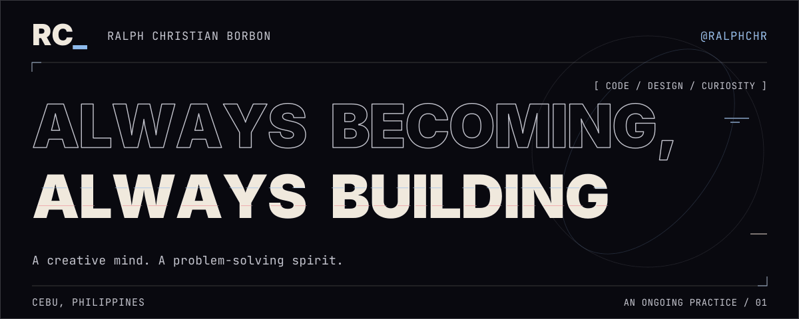
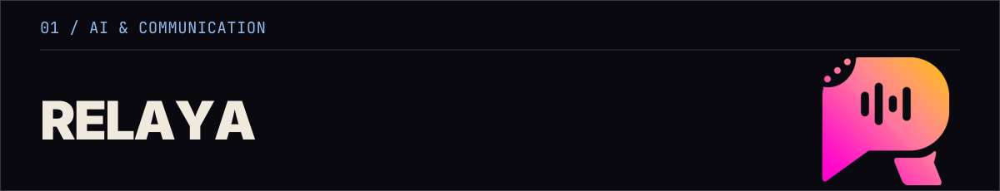
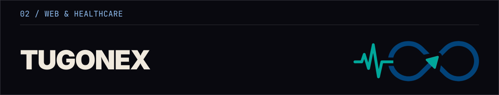
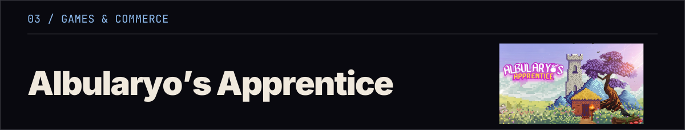
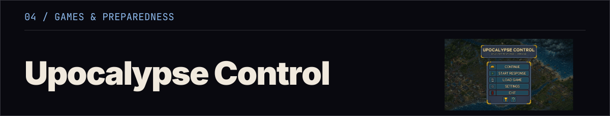
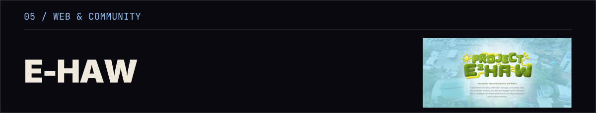
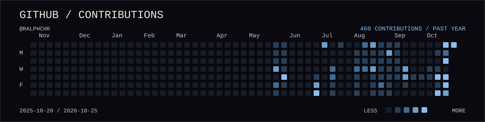

<picture>
  <source media="(prefers-reduced-motion: reduce) and (max-width: 600px)" srcset="./assets/profile-banner-mobile.svg">
  <source media="(prefers-reduced-motion: reduce)" srcset="./assets/profile-banner.svg">
  <source media="(max-width: 600px)" srcset="./assets/profile-banner-mobile.gif">
  
</picture>

# Ralph Christian Borbon

I’m Ralph, a **Computer Science student at UP Cebu**, based in **Cebu, Philippines**. I write code, shape visual identities, and build interactive experiences.

My interests move between software development, design, AI, games, and cybersecurity. I’m drawn to work that connects those worlds: a clearer conversation, a more prepared community, or a game worth exploring.

## `01 /` Selected work

<picture>
  <source media="(max-width: 600px)" srcset="./assets/projects/relaya-mobile.png">
  
</picture>

A real-time assistant that turns mixed Filipino/Bisaya-English speech into clear English, with intent reconstruction, Context Guard, and user-controlled speech delivery.

**Approach:** `AI` · `Speech recognition` · `NLP`

<picture>
  <source media="(max-width: 600px)" srcset="./assets/projects/tugonex-mobile.png">
  
</picture>

An offline-first hospital queue app with local syncing during outages and calamities, plus AI-assisted consultation and doctor referral.

**Stack:** `React` · `TypeScript` · `Tailwind CSS`

<picture>
  <source media="(max-width: 600px)" srcset="./assets/projects/albularyo-mobile.png">
  
</picture>

A merchant simulation where players brew potions, set prices, and manage supplies.

**Stack:** `Godot 4` · `C++` · `GDExtension`

<picture>
  <source media="(max-width: 600px)" srcset="./assets/projects/upocalyse-mobile.png">
  
</picture>

A disaster-response city-builder with a procedural coastal barangay map, evacuation planning, and five disaster simulations.

**Stack:** `Godot 4` · `C++` · `GDExtension`

<picture>
  <source media="(max-width: 600px)" srcset="./assets/projects/ehaw-mobile.png">
  
</picture>

A responsive barangay assistance site for a UP Cebu NSTP-C project, bringing emergency reporting, ticket tracking, and community alerts together.

**Stack:** `HTML` · `CSS` · `JavaScript`

## `02 /` Toolkit

### Languages

  
  
  
  
  
  
  
  
  

### Frameworks & Libraries

  
  
  
  
  

### Applications & Development Tools

  
  
  
  

### Security Exploration

  
  
  

### Creative & Design Skills

#### Design Tools

  
  
  
  
  
  

#### Video & Motion Graphics

  
  

## `03 /` On GitHub

<picture>
  <source media="(max-width: 600px)" srcset="./assets/contributions-mobile.svg">
  
</picture>

[View my GitHub activity ↗](https://github.com/ralphchr?tab=overview)

## `04 /` Beyond the code

I’m a **Marketing Director at the UP Computer Science Guild**, a **seasonal tutor**, a **freelance graphic designer**, and a **gamer**.

## `05 /` Let’s connect

[Facebook](https://www.facebook.com/ralphchrr) · [LinkedIn](https://www.linkedin.com/in/ralph-christian-borbon-5923a2356/) · [Gmail](mailto:borbon.rchr@gmail.com)
